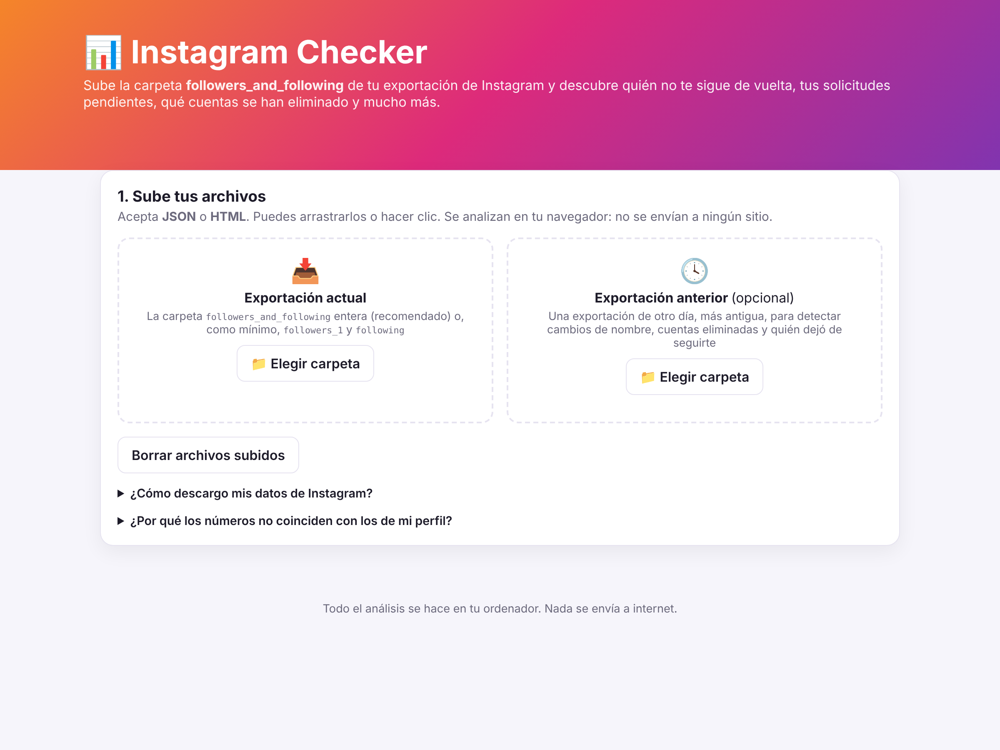
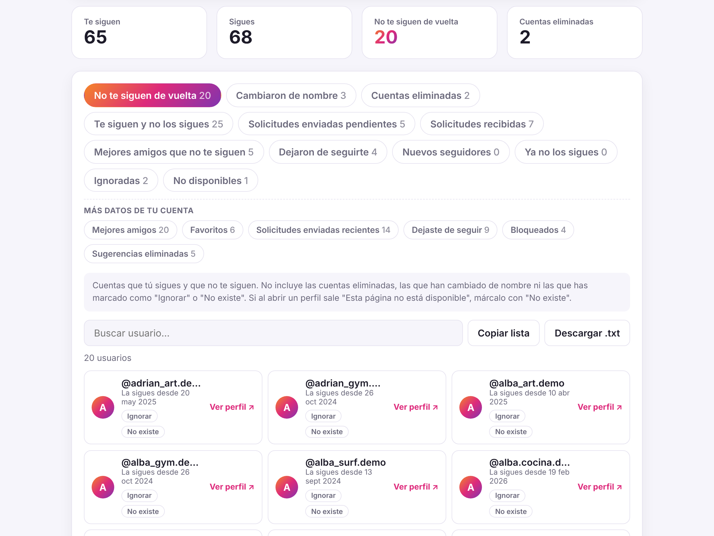
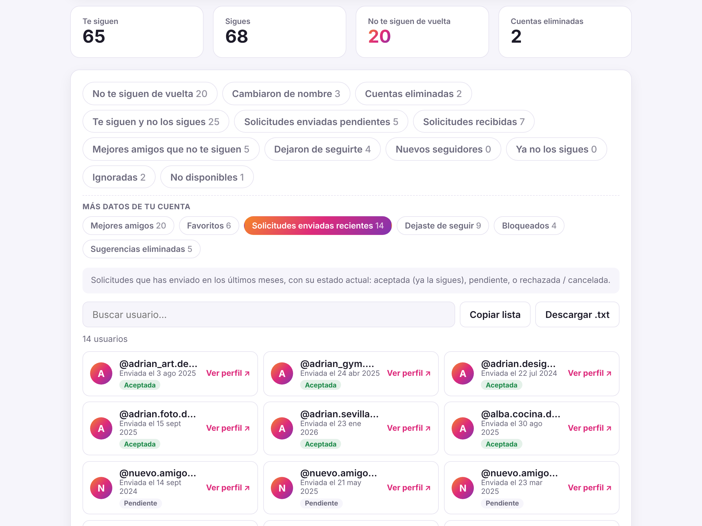
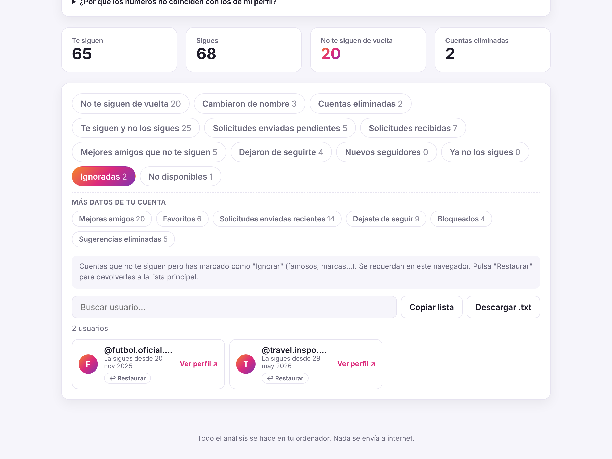
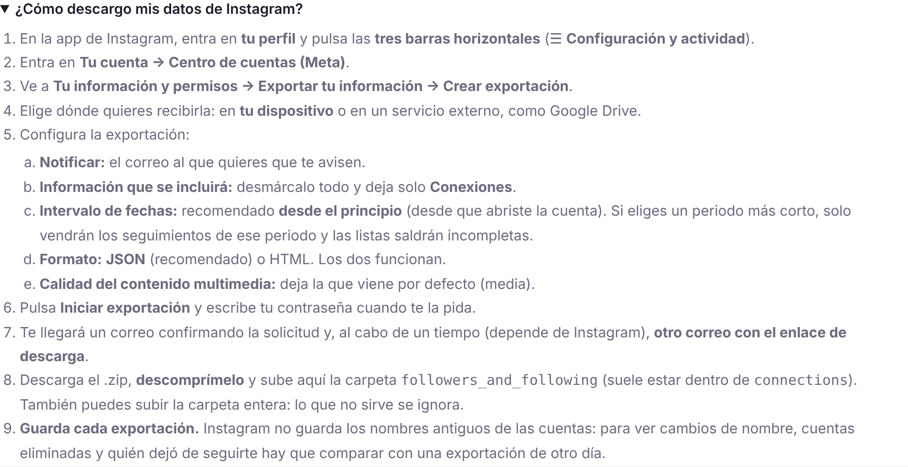

# Instagram Checker · ¿Quién no te sigue de vuelta?


Aplicación web que analiza la **exportación oficial de datos de Instagram** y te muestra **quién no te sigue de vuelta**, tus solicitudes pendientes, las cuentas eliminadas, los cambios de nombre y mucho más.

> 🔒 **Privacidad ante todo:** los archivos se procesan **en tu navegador**. No se envían a ningún servidor, no hace falta iniciar sesión y la app no se conecta a Instagram.



## ✨ Funcionalidades

**Lista principal: No te siguen de vuelta**
- Cuentas que sigues y que no te siguen, en orden alfabético y con la fecha desde la que las sigues.
- Botón **Ignorar** para apartar las cuentas que no te importan (famosos, marcas…).
- Botón **No existe** para apartar los perfiles que salen como "no disponibles" (cuentas desactivadas o suspendidas).
- Las marcas se **recuerdan en el navegador** para la próxima vez, y se pueden deshacer con **Restaurar**.
- Etiqueta **⭐ Mejor amigo** si alguien que no te sigue está en tu lista de Mejores amigos.

**Otras listas**
- Te siguen y no los sigues.
- Solicitudes **enviadas** pendientes y solicitudes **recibidas**.
- Mejores amigos que no te siguen.
- Cuentas eliminadas.
- Apartado **"Más datos de tu cuenta"**: mejores amigos, favoritos, solicitudes enviadas recientes (con su estado: aceptada, pendiente o rechazada), cuentas que dejaste de seguir, bloqueados y sugerencias eliminadas.

**Comparando con una exportación anterior**
- **Quién dejó de seguirte** y quiénes son tus **nuevos seguidores**.
- **Cambios de nombre**: detecta que una cuenta es la misma porque conserva la fecha exacta de seguimiento.
- El nombre que tenía una cuenta antes de **eliminarse**.

**Comodidades**
- Subes la carpeta `followers_and_following` entera: la app reconoce sola cada archivo e ignora el resto.
- Acepta la exportación en **JSON** o en **HTML**.
- Buscador, **copiar lista** y **descargar en .txt**.
- Modo oscuro automático según el sistema.

## 📸 Capturas

> Las capturas usan una **exportación de prueba con cuentas inventadas**.

**No te siguen de vuelta**



| Solicitudes enviadas recientes | Cuentas ignoradas |
|---|---|
|  |  |

**Instrucciones para descargar los datos de Instagram**



## 🚀 Cómo usarla

Necesitas [Node.js](https://nodejs.org/) 18 o superior. **No hay que instalar dependencias.**

```bash
git clone https://github.com/corderocana-dev/instagram-checker.git
cd instagram-checker
npm start
```

Se abre sola en `http://localhost:4000`. Después:

1. Descarga tus datos de Instagram (los pasos están explicados dentro de la propia app).
2. Descomprime el .zip y sube la carpeta **`followers_and_following`**.
3. Opcional: sube una exportación más antigua en **"Exportación anterior"** para ver cambios de nombre y quién dejó de seguirte.

## 🧠 Retos técnicos

- **Cada archivo de Instagram guarda el usuario en un sitio distinto.** En `followers_1.json` está en `string_list_data[].value`; en `following.json`, en `title`; y en el resto de archivos, dentro de `label_values` ("Nombre de usuario" o "URL"). La app normaliza los tres formatos.
- **La URL puede llevar un nombre antiguo.** En algunos archivos, si la cuenta cambió de nombre, la URL conserva el nombre viejo y el campo "Nombre de usuario" el actual. Se usa siempre primero el nombre de usuario.
- **Detectar cambios de nombre sin un identificador.** La exportación no trae el ID de las cuentas, así que se cruzan dos exportaciones por la **fecha exacta de seguimiento**. Solo se da por bueno un cambio cuando hay un único candidato con esa fecha, para no inventar coincidencias.
- **Ignorar los archivos que no interesan.** La exportación trae muchos archivos con el mismo formato (amigos íntimos, bloqueados, solicitudes…). Se distinguen por su nombre para que no se mezclen con los seguidores.

## ⚠️ Por qué las cifras no coinciden con las del perfil

El contador de tu perfil **no cuenta** las cuentas desactivadas temporalmente, suspendidas o eliminadas, pero **la exportación sí las incluye**. Por eso la exportación suele tener más "seguidos" que el perfil, y en "No te siguen de vuelta" pueden aparecer cuentas que, al abrirlas, dicen *"Esta página no está disponible"*. Para eso está el botón **No existe**.

## 📁 Estructura

```
instagram-checker/
├── src/
│   ├── web/
│   │   ├── index.html   # Estructura de la página
│   │   ├── estilos.css  # Estilos (modo claro y oscuro)
│   │   └── app.js       # Lógica: lectura de archivos, análisis y listas
│   └── servidor.js      # Servidor local mínimo que entrega la app y abre el navegador
├── docs/                # Capturas del README
└── package.json
```

El código está separado en **estructura (HTML), estilos (CSS) y lógica (JavaScript)**. El servidor solo entrega esos tres archivos: nada más del ordenador es accesible desde el navegador.

## 👤 Autor

**Antonio Cordero Caña** · [GitHub](https://github.com/corderocana)

---

Proyecto personal sin relación con Instagram ni con Meta. Usa únicamente la exportación de datos que Instagram ofrece a cada usuario.
